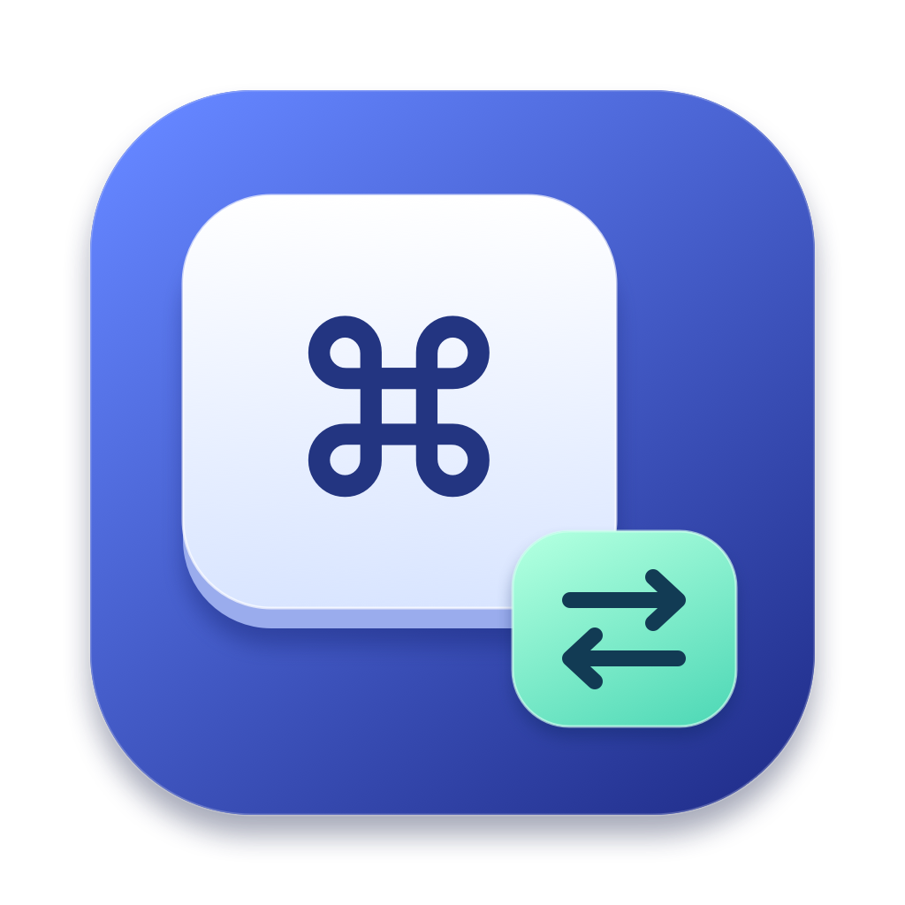

# 菜单改键 · Menu Rebind



给指定 Mac App 的菜单命令换快捷键。常见用途包括防止误关远程会话、标签页和文档窗口，以及给常用菜单命令分配更顺手的组合键。

菜单改键使用 macOS 的「App 快捷键」机制保存设置。设置完成后即可退出工具。 [Apple 的 App 快捷键说明](https://support.apple.com/zh-cn/guide/mac-help/mchlp2271/mac)

## 功能

| 功能 | 用法 |
| --- | --- |
| 自定义改键 | 用 macOS 原生文件选择窗口选取 `.app`，选取或填写菜单名称，再录制新快捷键 |
| 菜单名称发现 | 选中 App 后自动读取菜单资源和已有改键。点选标题时保留原始空格、标点和省略号 |
| 读取当前菜单 | 目标 App 在运行时，可以用辅助功能读取它当前的菜单，适合处理动态标题 |
| 查看改键记录 | 按 App 查看由菜单改键保存的命令、原有绑定和新快捷键 |
| 逐条恢复 | 恢复该命令先前的设置。原先使用默认键时，移除本工具为它添加的覆盖 |

## 系统要求

- macOS 14 或更新版本。
- 源码构建需要 Swift 6 工具链，例如 Xcode 16 或相应版本的 Command Line Tools，以及 Python 3。
- 打包脚本为运行构建的 Mac 生成对应架构的本地应用。

## 安装

获取源码需要仓库访问权限。

```bash
git clone https://github.com/imkkdev/menu-rebind.git
cd menu-rebind
python3 scripts/package.py --install
```

脚本先在 `dist/菜单改键.app` 生成并签名应用，再安装到「应用程序」。当前用户无法写入 `/Applications` 时，默认安装到 `~/Applications`。

如需指定安装目录，可以传入目录路径。

```bash
python3 scripts/package.py --install ~/Applications
```

安装好后，从访达的「应用程序」打开「菜单改键」。也可以用终端打开对应位置的应用。

```bash
open "/Applications/菜单改键.app"
```

### 本地签名

首次构建默认使用临时签名。临时签名随构建变化，升级后 macOS 可能需要重新确认辅助功能权限。若钥匙串已有代码签名证书，可以用 `security find-identity -v -p codesigning` 查看签名身份，再指定它安装。

```bash
python3 scripts/package.py --install --signing-identity "Apple Development: 你的签名身份"
```

后续更新时，脚本会复用目标 App 的签名证书。首次切换签名后，请在系统设置中重新添加当前版本；日常升级使用同一签名身份。

## 添加改键

1. 打开菜单改键，点「添加改键 → 选择应用…」。系统文件选择窗口默认打开「应用程序」，也可以浏览其他文件夹，选取目标 `.app`。
2. 点「选取菜单」，选择要改键的命令。也可以直接在「菜单名称」输入原文。手动输入完整路径时，用 `->` 分隔层级，例如 `文件->关闭`。
3. 点击「录制快捷键…」，按下所需组合键，例如 `Control + Option + Command + W`。可以录制带修饰键的组合和单独的 F1–F20。录制过程中可按 Esc 取消。
4. 点「应用改键」。重新打开目标 App 后，查看菜单旁显示的新键，再试原快捷键。

| 符号 | 键名 |
| --- | --- |
| `⌃` | Control |
| `⌥` | Option |
| `⇧` | Shift |
| `⌘` | Command |

### 找到准确的菜单名称

- **系统已有改键**来自 macOS 为该 App 保存的快捷键设置。以前手动改过的标题也会出现在这里。
- **安装包候选**来自 App 的菜单本地化资源，按 App 语言优先查找。安装包里可能只有通用字样，例如存有「关闭」，而运行时显示「关闭网易UU远程」。
- **当前菜单**按所选 `.app` 定位到它的运行进程，并跳过左上角的  系统菜单。先打开目标窗口，再点「读取运行中的菜单…」。结果会显示 App 名称，同名菜单会带上路径，已有改键和安装包候选可以展开查看。

首次读取时，若 App 提示需要辅助功能权限，点「打开辅助功能设置」，用 `+` 添加工具显示的这份「菜单改键」并开启。若升级后列表里已经开启，但工具仍提示授权，先用 `−` 移除旧条目再重新添加。返回菜单改键后会重新检查权限。

优先选目标 App 当前显示的标题。macOS 按菜单原文匹配，多输一个空格也可能导致改键无效。列表里的「手动填写参考」提供中英文常用示例。

## 恢复和卸载

在「已改键」里找到目标规则，点右边的「恢复」。如果用本工具多次修改同一条规则，它会保存第一次改动前的值。如果该命令随后在系统设置里被改成其他值，恢复时会提示冲突并保留当前值。

如果系统已经存有与你本次选择相同的改键，工具会提示已设置。已有的系统改键可以在 macOS 的「App 快捷键」页面查看或恢复。

也可以打开 **系统设置 → 键盘 → 键盘快捷键 → App 快捷键**，选中对应条目，按需要修改或移除。重新打开目标 App 后验证。

改键由 macOS 保存，因此移走 `菜单改键.app` 后，已应用的快捷键仍然生效。如需卸载并还原，先在工具里恢复相应规则，再将应用移到废纸篓。

## 兼容范围和排查

- **菜单标题**决定规则匹配的对象。动态标题、语言切换和版本更新可能需要重新填写。菜单右侧的快捷键符号用于验证，标题字段只填菜单命令文字。
- **键位冲突**会影响结果。某个新键已经被目标 App 使用时，请换一组键，并以目标菜单中最终显示的按键为准。
- **App 兼容性**取决于它是否接受 macOS 的菜单快捷键偏好。网页内自定义键、游戏键位、App 自己处理的组合键和 `⌘Tab` 等系统级操作需要通过各自的设置解决。

## 本地数据与权限

工具通过 Core Foundation 首选项 API 更新目标 App 对应的当前用户配置 `NSUserKeyEquivalents`。改动以单条菜单命令为单位，写入时合并同一 App 的其他快捷键。每笔修改的原值和恢复记录存放在 `~/Library/Application Support/Menu Rebind/rules.json`。

录制快捷键时，按钮只接收菜单改键窗口内的输入。读取安装包资源、录制和应用改键无需额外权限。读取运行中的菜单使用可选的辅助功能权限。规则与目标 App 路径保存在本机。

## 源码构建和测试

```bash
xcrun swift test
python3 scripts/package.py
open "dist/菜单改键.app"
```

- `Sources/MenuRebind` 包含 SwiftUI 窗口、AppKit 原生文件选择、运行中菜单读取和快捷键录制。
- `Sources/MenuRebindCore` 负责读取菜单资源、读写单个 App 的快捷键、记录原值以及恢复规则。
- `Tests/MenuRebindCoreTests` 使用临时 App 和隔离的配置域，验证菜单原文、改键、恢复、外部改动和中断后的恢复。
- `scripts/package.py` 将 `Assets/AppIcon.png` 打包为 macOS 图标，生成并签名 `.app`。安装脚本在同名路径下只替换使用本项目 Bundle ID 的应用。

### 后续方向

可以探索可分享的改键方案，让社区一起整理和维护常见 App 的配置。在工具中预览他人分享的方案后，可以一键应用需要的改键。
